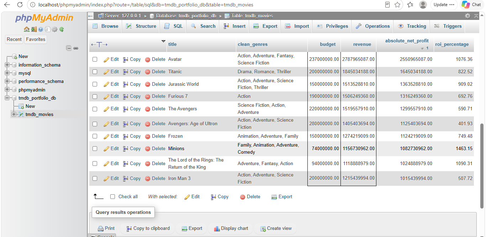
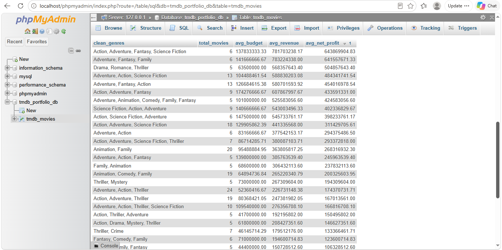

# 🔍 Module 02: Relational Database Ingestion & Querying (SQL)

## Database Architecture
* **Engine:** MariaDB / MySQL (via XAMPP)
* **Database:** `tmdb_portfolio_db`
* **Table:** `tmdb_movies` (14 columns mapped from cleaned dataset)

## Analytical Queries Executed

### 1. Top 10 Movies by Absolute Net Profit
Isolated high-budget films (`budget > $1M`) with positive box-office returns to identify top-performing cinema assets and calculate exact ROI percentages.

### 2. Financial Performance by Genre Combination
Aggregated production budgets, gross revenues, and net profits across multi-genre classifications (filtered for categories with at least 5 films to ensure statistical relevance).

