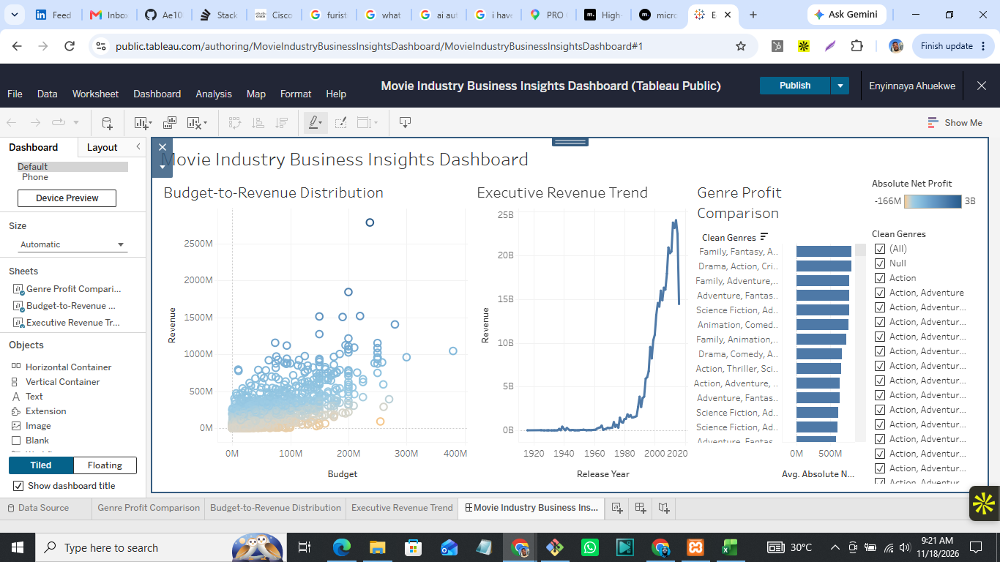

# 🎨 Module 03: Interactive Data Visualization (Tableau Public)

## 🔗 Live Interactive Dashboard
Explore and filter the live executive dashboard on Tableau Public:  
👉 **[View Live Movie Industry Business Insights Dashboard](PASTE_YOUR_PUBLIC_URL_HERE)**

## 📊 Dashboard Architecture
* **Budget-to-Revenue Distribution:** Scatter plot mapping production spending against box-office gross revenue, color-coded by net profit margin.
* **Executive Revenue Trend:** Historical time-series line chart tracking cumulative industry revenue growth across release years.
* **Genre Profit Comparison:** Ranked horizontal bar chart evaluating average net profitability across multi-genre classifications.
* **Global Interactivity:** Configured the `Clean Genres` filter card across all worksheets using the same data source for real-time executive slicing.

